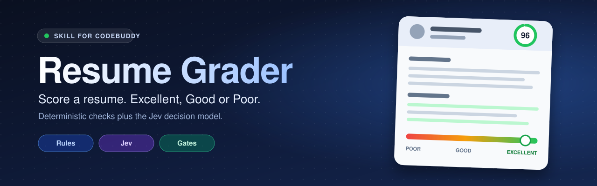

<p align="center">
  
</p>

<h1 align="center">resume-grader</h1>

<p align="center">
  <strong>给简历打分,判定 优秀 / 良 / 差</strong><br>
  <sub>本地规则检查 + Jev 决策模型语义判断 + 应用侧阈值与闸门</sub>
</p>

<p align="center">
  
  
  
  
</p>

<p align="center">
  <a href="#快速开始">快速开始</a> •
  <a href="#配置-jev">配置 Jev</a> •
  <a href="#评分如何工作">评分规则</a> •
  <a href="#用法">用法</a> •
  <a href="#排错">排错</a> •
  <a href="#隐私与安全">隐私与安全</a>
</p>

<p align="center">
  <sub>
    规则检查可复现 · 语义判断来自 Jev 的概率输出 · 阈值与封顶规则由本地代码决定<br>
    扫描件、乱码、Jev 不可用时直接报错,不会给出估算结果
  </sub>
</p>

---

## 这是什么

一个可移植的 Agent Skill(也可以直接当命令行工具用):给它一份简历(可选再给一份岗位 JD),输出 **优秀 / 良 / 差** 三档结论、分项分数、触发的封顶规则和可执行的修改建议。

遵循通用 Agent Skills 结构(`SKILL.md` + `scripts/` + `references/`),不绑定某个客户端。

| 部分 | 做什么 | 特点 |
|---|---|---|
| 规则检查 | 联系方式、章节、日期格式、量化成果、措辞、JD 关键词 | 本地运行,无 LLM,可复现 |
| Jev 判断 | 成果证据、职责深度、清晰度、岗位匹配、总评、夸大 / 矛盾 / 空窗风险 | 一次请求多个问题,返回概率 |
| 阈值与闸门 | 综合分、等级划分、封顶、人工复核标记 | 由本地代码决定,不交给模型 |

支持 `.pdf` `.docx` `.md` `.txt` `.json`,中英文简历均可。

---

## 效果示例

在测试网关上的结果(2026-11-02),模型 `jev-1.13.0`。

| 样例 | 等级 | 综合分 | 说明 |
|---|---|---|---|
| 成果清晰、数字充分的后端简历 | 优秀 | 96.2 | 成果证据 99.5,三个风险信号均低于 0.1 |
| 只写职责、无联系方式的简历 | 差 | 17.8 | 成果证据 0,"空泛自评"概率 0.73,并给出改写建议 |
| 同一份强简历,对照要求 Rust 的 JD | 良 | 89.9 | "必备项满足"概率仅 0.09,从优秀封顶为良 |

报告节选:

```text
# Resume grade: 良

- Composite score: 89.9 (excellent >= 80, good >= 60)
- Grade before caps: 优秀
- Judge: Jev jev-1.13.0 (quality 87.1, redacted=True)

## Caps applied
- [良 max] must_have_met p=0.09: a must-have requirement is not evidenced

## Suggestions
- Keywords not found: Rust. Add them only where truthful.
```

---

## 快速开始

要求 Python 3.10 及以上,只用标准库,没有 `pip install` 步骤。

**1. 安装 skill(可选)**

不安装也能用:直接跑下面的 Python 命令即可。想让它作为 Agent Skill 被自动加载时,把仓库放进你所用工具的 skills 目录:

```bash
# 个人使用,所有项目可用(<skills-dir> 见下表)
cp -R resume-grader <skills-dir>/resume-grader

# 或只给某个项目使用
cp -R resume-grader <项目根目录>/<skills-dir>/resume-grader
```

| 工具 | `<skills-dir>` |
|---|---|
| 通用 Agent Skills 约定 | `~/.agents/skills` |
| Claude Code | `~/.claude/skills` |
| CodeBuddy | `~/.codebuddy/skills` |
| 其他工具 | 查该工具的 skills 目录文档 |

**2. 读 PDF 需要 pdftotext(poppler)**

```bash
brew install poppler                  # macOS
sudo apt-get install poppler-utils    # Debian / Ubuntu
```

只处理 `.docx` `.md` `.txt` `.json` 时可以不装。

**3. 配置 Jev 密钥**(详见下一节)

```bash
export JEV_API_KEY="你的密钥"
```

**4. 跑一遍**

```bash
python3 -B scripts/score_resume.py resume.pdf
```

也可以在你使用的 Agent 工具里直接说:"帮我给这份简历打分" 并附上文件路径。

---

## 配置 Jev

通过环境变量配置,脚本不读配置文件。

| 变量 | 必填 | 说明 |
|---|---|---|
| `JEV_API_KEY` | 是 | Jev 的 API key。也接受 `TYPESAFE_API_KEY` |
| `JEV_BASE_URL` | 否 | 网关根地址,脚本自动拼上 `/v1/systemone`,例如 `https://gw.example.com` |
| `JEV_ENDPOINT` | 否 | 完整请求地址。路径不是 `/v1/systemone` 时用它,优先级高于 `JEV_BASE_URL` |
| `JEV_MODEL` | 否 | 模型名,默认 `jev-1.13.0`。命令行 `--model` 优先 |
| `JEV_ALLOW_HTTP` | 否 | 设为 `1` 才允许非本机的 `http://` 地址 |

解析顺序:

- 地址:`JEV_ENDPOINT` -> `JEV_BASE_URL` + `/v1/systemone` -> 官方默认 `https://api.typesafe.ai/v1/systemone`
- 密钥:`JEV_API_KEY` -> `TYPESAFE_API_KEY`

### 场景 A:官方 TypeSafe API

```bash
export JEV_API_KEY="你的密钥"
```

不需要设置地址。

### 场景 B:内部或第三方网关

```bash
export JEV_API_KEY="网关发的密钥"
export JEV_BASE_URL="https://你的网关域名"
# 网关上的 Jev 路径或模型名与官方不同时再加:
# export JEV_ENDPOINT="https://你的网关域名/某个路径"
# export JEV_MODEL="网关上的模型名"
```

网关必须兼容 TypeSafe 的 System One 请求格式:`POST`,请求体 `{model, state, questions}`,响应里有 `answers`,并用 `Authorization: Bearer <key>` 鉴权。格式不兼容时脚本会报错退出,不会猜测结果。

### 场景 C:网关只有 http 地址

http 会让密钥和简历内容明文传输,默认被拒绝。确认网络可信(如内网)后才显式放行:

```bash
export JEV_BASE_URL="http://内网地址"
export JEV_ALLOW_HTTP=1
```

`localhost` 和 `127.0.0.1` 不需要这个开关。

### 已验证的网关示例

下面这组配置已在兼容网关实测跑通过(强简历判优秀、弱简历判差、带 JD 的路径也正常):

```bash
export JEV_API_KEY="你的网关密钥"
export JEV_BASE_URL="https://你的网关域名"
export JEV_ALLOW_HTTP=1  # 仅当网关只提供 http 时需要
```

网关上的路径是 `/v1/systemone`,模型 `jev-1.13.0`,不需要设置 `JEV_ENDPOINT` 和 `JEV_MODEL`。网关密钥只对该网关有效;用错密钥会得到 401,响应和不带密钥时完全一样。

网关的校验比官方文档严格:`noul`(是否)题带任何 `criteria` 字段都会返回 400 `INVALID_REQUEST`,连 `null` 也不行。本 skill 的 `noul` 题因此只用 `instructions`,真假含义写在题干里。自己加题时请照此处理。

### 让配置长期生效

把 `export` 写进 shell 配置文件(`~/.zshrc` 或 `~/.bashrc`),然后执行 `source ~/.zshrc`。

不要把密钥写进项目文件、命令行参数,也不要提交到 git。用 `.env` 文件管理时,务必加进 `.gitignore`。

在 Agent 工具里使用时,环境变量要在启动该工具的那个终端或系统环境里已经存在。启动之后再 `export` 不会传给已运行的进程,需要重启。

### 验证配置

先跑离线自检,确认脚本本身正常(不联网、不需要密钥):

```bash
python3 -B scripts/selftest.py
```

再用一份简历做真实调用。输出里出现 `Judge: Jev jev-x.y.z` 即表示 Jev 调用成功。

---

## 评分如何工作

```text
简历 + (可选) JD
   |
   |-- 规则检查 ---------> 规则分 0-100
   |                          |
   |-- Jev (一次请求) ----> 质量分 0-100 + 风险概率
                              |
        综合分 = 0.65 x 质量分 + 0.35 x 规则分 - 风险扣分
                              |
              封顶闸门 --> 等级:优秀 >= 80 / 良 >= 60 / 差
```

| 分项 | 来源 | 内容 |
|---|---|---|
| completeness | 规则 | 联系方式 + 经历、教育、技能三个章节 |
| writing | 规则 | 职责词开头、第一人称、过长、无数字、重复开头 |
| metrics | 规则 | 含数字的要点占比,50% 即满分 |
| date_consistency | 规则 | 日期区间主导格式占比 |
| keywords | 规则 | `--keywords` 命中率(整词匹配,中文子串匹配) |
| impact / depth / clarity / relevance | Jev score | 成果、深度、清晰度、岗位匹配,0-4 级,取概率期望 |
| verdict | Jev choice | 优秀 / 良 / 差 总评 |
| vague_claims / inconsistency / unexplained_gap / must_have_met | Jev noul | 空泛自评、时间线矛盾、空窗、JD 必备项 |

封顶规则(取最低者):缺邮箱和手机、无经历章节、全文少于 300 字符、时间线矛盾概率 >= 0.7、JD 必备项未满足、规则模式(无 Jev)。

综合分距阈值不足 3 分、Jev 总评置信度低于 0.6、Jev 总评与综合等级不一致时,报告会标记需要人工复核。

完整公式、权重和题目设计见 [references/rubric.md](references/rubric.md)。

---

## 用法

```bash
# 基本评分
python3 -B scripts/score_resume.py resume.pdf

# 对照岗位 JD,并检查必备关键词
python3 -B scripts/score_resume.py resume.pdf --jd jd.txt --keywords "Python,Kafka,MySQL"

# 输出 JSON,便于批量处理
python3 -B scripts/score_resume.py resume.pdf --json

# 调整等级阈值(默认优秀 80、良 60)
python3 -B scripts/score_resume.py resume.pdf --excellent 85 --good 65

# 不把简历发给第三方:只做格式和写作规范检查
python3 -B scripts/score_resume.py resume.pdf --no-jev
```

`--no-jev` 模式等级最高到"良",报告会标注 `Judge: NONE`,不是完整评估。

在任意 Agent 工具里触发的说法示例:

- "帮我给这份简历打分" 并附上文件路径
- "这份简历对照这个 JD,是优秀、良还是差"
- "筛一下 resumes 目录里的简历"

助手会按 [SKILL.md](SKILL.md) 的流程运行脚本,并汇报等级、分项、触发的封顶规则和修改建议。

---

## 排错

任何 Jev 失败都以退出码 2 结束,不会降级成估算结果。

| 现象 | 含义 |
|---|---|
| `error: JEV_API_KEY (or TYPESAFE_API_KEY) is not set` | 没设置密钥 |
| `Jev API returned HTTP 401` 或 `403` | 密钥错误、过期、没有 Jev 权限,或缺少鉴权头 |
| `Jev API returned HTTP 400` | 模型名不对、简历过大,或请求字段不符合网关 schema(如 `noul` 题带了 `criteria`) |
| `Jev API returned HTTP 404` | 路径不对,用 `JEV_ENDPOINT` 指定完整地址 |
| `Jev API returned HTTP 422` | 请求字段不被网关接受,网关可能不兼容 |
| `Jev API returned HTTP 429` / `529` | 限流或过载,脚本已自动重试 2 次后才报错 |
| `the Jev endpoint must be https` | 地址是非本机 http,见场景 C |
| `network error calling Jev` | 网络不通、地址写错或超时(30 秒) |
| `Jev answer for '...' is missing or has the wrong type` | 网关返回的结构与 TypeSafe 不一致 |
| `extracted text looks garbled` | PDF 字体映射损坏或是扫描件,先 OCR 或导出为文本 |
| `pdftotext not found` | 未安装 poppler,见快速开始 |

区分"密钥不对"和"地址不对"的办法:对同一个地址分别用"不带密钥""乱写的密钥""你的密钥"各请求一次。三者都返回同样的 401,说明地址对、密钥不被认识;只有你的密钥得到 200,才说明密钥有效。路径不存在时,nginx 会返回 404 而不是 401。

---

## 隐私与安全

- 简历正文会发送到你配置的 Jev 地址。发送前默认把邮箱和手机号替换为 `[EMAIL]` `[PHONE]`;姓名、公司名不会被遮蔽。
- `--no-redact` 会原样发送联系方式,仅在你明确同意时使用。
- 密钥只从环境变量读取,脚本不会把它写入任何文件或输出。
- 地址必须是 https;非本机 http 需要显式设置 `JEV_ALLOW_HTTP=1`。
- 在对话或聊天工具里贴过的密钥应视为已泄露,验证完后请轮换。

---

## 测试情况

| 层 | 内容 | 结果 |
|---|---|---|
| 离线自检 | 42 项,用模拟的 Jev 返回值测评分、封顶、重试、脱敏、校验,并用现场生成的 DOCX / PDF 测文件加载 | 通过。只能证明代码逻辑自洽,不能证明 Jev 判断得对 |
| 文件格式 | `.txt` `.docx` `.pdf` 对同一份简历提取后的分项一致;扫描件、损坏文件、空文件、旧 `.doc` 都报明确错误 | 通过。PDF 用 `pdftotext`,表格版式 DOCX 已覆盖 |
| 真实网关评测 | `tests/eval_samples.py`:12 份自编样本(优秀 / 良 / 差各 4,中英文各半),每份调用 3 次 | 见下 |

12 份样本的结果(每份 3 次):

| 预期 \ 预测 | 优秀 | 良 | 差 |
|---|---|---|---|
| 优秀 | 4 | 0 | 0 |
| 良 | 1 | 3 | 0 |
| 差 | 0 | 0 | 4 |

- 吻合 11/12,没有"优秀与差"互相误判。三档综合分区间不重叠:优秀 87.3-98.1,良 66.3-83.5,差 22.1-48.5。
- 同一份简历 3 次调用的综合分最大波动 4.9 分(其余多在 0.5 分以内),等级没有变过。
- 唯一不吻合的是一份营销经理简历:有可量化的成果,综合分 83.5 过了优秀线,但 Jev 自己的总评是"良"(概率 0.87)。这种"总评与综合等级不一致"的情况会标记为需要人工复核,而不是悄悄给出结论。

这些数据只能说明三件事:档位排序合理、结果可重复、没有离谱误判。**不能当作准确率**:样本由我自己编写,标签也由我定,真实世界的简历更杂。样本只有 12 份,"良"这一档边界最模糊,判断也最不可靠。

```bash
# 离线自检(不联网)
python3 -B scripts/selftest.py

# 真实网关评测(会发起约 36 次请求,默认每次间隔 4 秒以避开限流)
python3 -B tests/eval_samples.py --repeats 3
```

---

## 已知限制

- Jev 可能给出"合法但错误"的答案。默认阈值和权重是起点,没有用真实标注样本校准过;有已标注的优秀 / 良 / 差简历后,先批量跑 `--json`,对比 `composite` 与人工标签再调阈值。
- 测试网关有限流,没有返回额度或 `Retry-After` 头。连续大批量调用会收到 429,客户端会重试 2 次,仍失败则报错;批量评测请用 `tests/eval_samples.py` 的限速参数 `--pause`。
- 规则只看提取出的文本。PDF 的多栏、表格、页眉页脚、图片等版式问题看不到,本 skill 未做版面分析。
- 单次请求上限 15000 字符。
- 姓名和公司名不遮蔽,发送前请确认可以外发。

---

## 目录结构

```text
resume-grader/
  README.md                本文件
  SKILL.md                 助手执行流程
  assets/
    cover.svg              封面图
  scripts/
    score_resume.py        入口:合成分数、闸门、报告
    jev_client.py          Jev 请求、重试、答案校验
    resume_features.py     简历读取与规则检查
    selftest.py            离线自检
  tests/
    eval_samples.py        真实网关评测(混淆矩阵、重复稳定性)
    samples/               12 份自编样本,按 优秀 / 良 / 差 命名
  references/
    rubric.md              评分公式、题目、闸门
    sources.md             参考的开源项目与取舍
```

---

## 参考项目

规则检查的思路取自 [srbhr/Resume-Matcher](https://github.com/srbhr/Resume-Matcher)(加权评分、日期一致性、写作规则、整词关键词匹配)和 [xitanggg/open-resume](https://github.com/xitanggg/open-resume)(文本必须先能还原成章节结构)。语义判断使用 TypeSafe AI 的 Jev。取舍的详细说明见 [references/sources.md](references/sources.md)。
